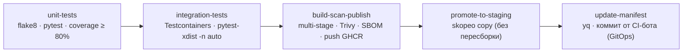

# CICDLabs — сквозной CI/CD-пайплайн для Python/Flask-приложения

[](https://github.com/oleglaptev/CICDLabs/actions/workflows/ci.yml)

Учебный проект по дисциплине «Технологии сборки и развертывания ПО» (НИ ТПУ, гр. 8ПМ63).
Четыре лабораторные работы, собранные в единую систему: от коммита в git до **безопасного развёртывания в Kubernetes с автоматическим откатом по метрикам без участия человека**.

| ЛР | Этап пайплайна | Результат |
|----|----------------|-----------|
| 1 | Базовый CI | Линтинг, unit-тесты с Quality Gate по покрытию 80% |
| 2 | Сборка и публикация | Multi-stage образ, Trivy-гейт, SBOM, публикация в GHCR |
| 3 | Интеграционное тестирование и продвижение | Testcontainers, параллельные тесты, GitOps-продвижение в staging |
| 4 | Стратегии развёртывания и откат | Rolling Update, Canary (Argo Rollouts), автоматический Rollback по метрикам Prometheus |

---

## Приложение

Flask-фабрика `create_app()` (`app/__init__.py`), запуск через gunicorn:

| Эндпоинт | Назначение |
|----------|------------|
| `GET /health` | Health-check; при `CHAOS_MODE=true` с вероятностью 0.3 отвечает `500` (механизм демонстрации отката, ЛР4) |
| `GET /new-feature` | Демонстрационный маршрут нового функционала |
| `GET /visits` | Счётчик посещений: запись в PostgreSQL + кэш Redis с TTL 10 c (ЛР3) |
| `GET /metrics` | Метрики Prometheus: `http_requests_total{status_code}` (ЛР4) |

Внешние зависимости: PostgreSQL 16, Redis 7 (поднимаются эфемерно в интеграционных тестах через Testcontainers).

---

## CI/CD-пайплайн (GitHub Actions)

Триггеры: `push` и `pull_request` в `main`. Публикация и продвижение — только из `main`.



- **Quality Gate по покрытию**: `pytest --cov-fail-under=80` (порог в `setup.cfg`; `app/visits.py` исключён из unit-покрытия, закрыт интеграционными тестами).
- **Quality Gate по безопасности**: Trivy `--severity HIGH,CRITICAL --ignore-unfixed`; уязвимые vendored-копии pip/setuptools/wheel удаляются из образа на этапе сборки (security hardening).
- **Immutable-артефакты**: тег образа = короткий SHA коммита; образ копируется в staging-реестр `skopeo` без пересборки, затем CI-бот обновляет тег в `k8s-manifests/staging/deployment.yaml` отдельным коммитом.

---

## Лабораторные работы

### ЛР1. Настройка базового CI-пайплайна
GitHub Actions: установка зависимостей с кэшированием pip, `flake8`, unit-тесты с контролем покрытия, шаг сборки `py_compile`. Эксперимент: добавление кода без тестов роняет покрытие ниже 80% и блокирует пайплайн.

### ЛР2. Сборка Docker-образов и работа с реестром
Multi-stage сборка (`builder` → `runtime` на `python:3.11-slim`): уменьшение образа более чем в 8.5 раз. Кэширование слоёв через `cache-from/to: type=gha` с избирательной инвалидацией. Сканирование Trivy, генерация SBOM (CycloneDX), публикация в GHCR с lower-case-нормализацией имени репозитория.

### ЛР3. Интеграционное тестирование и продвижение артефактов
Тесты `/visits` против реальных PostgreSQL и Redis в эфемерных контейнерах (Testcontainers), параллельный прогон `pytest-xdist`. Продвижение верифицированного образа в `-staging`-реестр через `skopeo` и GitOps-обновление манифеста staging-Deployment.

### ЛР4. Стратегии развёртывания и автоматический откат (объединяющая)

Локальный стенд: **kind**-кластер `cicd-lab4` с local registry `localhost:5001`, **kube-prometheus-stack** (релиз `monitoring`), **Argo Rollouts**, namespace `staging`.

Схема безопасного выката:

```
Rollout myapp (6 реплик), canary-шаги:
setWeight 10 → pause 1m → setWeight 25 → pause 1m → setWeight 50 → pause 1m → setWeight 100
        └────────── фоновый AnalysisTemplate error-rate-check ──────────┘
                     запрос к Prometheus каждые 30 c:
                     sum(rate(http_requests_total{status_code=~"5.."}[1m]))
                     / sum(rate(http_requests_total[1m]))
                     порог: result[0] < 0.01, failureLimit: 1
                     при превышении → Degraded → автоматический откат + уведомление
```

Ключевые компоненты:
- `k8s-manifests/deployment.yaml` — Deployment со стратегией RollingUpdate (`maxUnavailable: 1`, `maxSurge: 2`) + Service `myapp`;
- `k8s-manifests/rollout.yaml` — Rollout с canary-стратегией, сервисами `myapp-stable`/`myapp-canary` и подключённым анализом;
- `k8s-manifests/analysistemplate.yaml` — AnalysisTemplate `error-rate-check` (PromQL-запрос доли 5xx);
- `k8s-manifests/podmonitor.yaml` — PodMonitor (метка `release: monitoring`, `/metrics`, порт 3000);
- `k8s-manifests/notify-rollback.sh` — упрощённый механизм уведомлений: локальный скрипт отслеживает код возврата `kubectl argo rollouts status` и фиксирует уведомление в `notification.txt`;
- `kind-registry.sh` — создание кластера kind с подключённым local registry.

Образы для демонстрации: `localhost:5001/myapp:stable` и `:broken` (тот же Dockerfile, build-arg `CHAOS_MODE=true`).

**Результат демонстрации**: выкат `:broken` → canary получил ~14% трафика (1 pod из 7) → AnalysisTemplate зафиксировал долю 5xx 1.10%, затем 2.91% (пик на графике Prometheus ≈ 3.1%) → второе Failed-измерение превысило `failureLimit: 1` → Rollout перешёл в `Degraded` и **без участия человека** вернул трафик на стабильную версию (~68 c от старта выката до отката), уведомление зафиксировано.

---

## Структура репозитория

```
CICDLabs/
├── .github/workflows/ci.yml        # CI/CD-пайплайн (ЛР1–ЛР3)
├── app/
│   ├── __init__.py                 # фабрика приложения, /health, /metrics, CHAOS_MODE
│   └── visits.py                   # blueprint /visits (PostgreSQL + Redis)
├── tests/
│   ├── unit/test_app.py            # unit-тесты, включая метрики и CHAOS_MODE
│   └── integration/test_visits.py  # интеграционные тесты (Testcontainers)
├── k8s-manifests/
│   ├── staging/deployment.yaml     # GitOps-манифест staging (ЛР3)
│   ├── podmonitor.yaml             # PodMonitor для Prometheus (ЛР4)
│   ├── deployment.yaml             # Deployment + Service, Rolling Update (ЛР4)
│   ├── rollout.yaml                # Rollout + canary-сервисы (ЛР4)
│   ├── analysistemplate.yaml       # AnalysisTemplate error-rate-check (ЛР4)
│   └── notify-rollback.sh          # скрипт уведомления об откате (ЛР4)
├── Dockerfile                      # multi-stage сборка (ЛР2), порт 3000 и CHAOS_MODE (ЛР4)
├── Dockerfile.singlestage          # одностадийная сборка для сравнения размеров (ЛР2)
├── requirements.txt                # dev-зависимости
├── requirements-prod.txt           # production-зависимости
├── run.py                          # точка входа (create_app)
├── setup.cfg                       # pytest / flake8 / coverage (порог 80%)
├── kind-registry.sh                # кластер kind + local registry (ЛР4)
└── README.md
```

---

## Быстрый старт

### Тесты и линтинг локально

```bash
python -m venv venv && source venv/bin/activate
pip install -r requirements.txt
flake8 app tests
pytest tests/unit/ --cov=app --cov-fail-under=80
pytest tests/integration/ -v -n auto   # требует Docker для Testcontainers
```

### Сборка образов

```bash
docker build -t myapp:local .
docker build --build-arg CHAOS_MODE=true -t myapp:broken .   # «сломанная» версия
```

### Стенд ЛР4 (локальный кластер и демонстрация отката)

```bash
# 1. Кластер kind с local registry + мониторинг
./kind-registry.sh
helm install monitoring prometheus-community/kube-prometheus-stack \
  --namespace monitoring --create-namespace --set grafana.enabled=false
kubectl create namespace staging
kubectl apply -f k8s-manifests/podmonitor.yaml
kubectl apply -n argo-rollouts -f https://github.com/argoproj/argo-rollouts/releases/latest/download/install.yaml

# 2. Образы в local registry
docker build -t localhost:5001/myapp:stable . && docker push localhost:5001/myapp:stable
docker build --build-arg CHAOS_MODE=true -t localhost:5001/myapp:broken . && docker push localhost:5001/myapp:broken

# 3. Базовый Deployment (Rolling Update), затем Rollout (Canary)
kubectl apply -f k8s-manifests/deployment.yaml
kubectl delete deployment myapp -n staging
kubectl apply -f k8s-manifests/rollout.yaml
kubectl apply -f k8s-manifests/analysistemplate.yaml

# 4. Нагрузка и демонстрация автоматического отката
kubectl run load -n staging --image=curlimages/curl --restart=Never -- \
  sh -c 'while true; do curl -s -o /dev/null http://myapp/health; sleep 0.1; done'
kubectl argo rollouts set image myapp myapp=localhost:5001/myapp:broken -n staging
kubectl argo rollouts get rollout myapp -n staging --watch   # наблюдать откат
```

---

## Ключевые технические решения

- **Python + Flask + gunicorn** — минималистичный стек, позволяющий сосредоточиться на процессах CI/CD.
- **GitHub Actions** — бесплатные минуты для учебных репозиториев, нативный кэш слоёв Docker (`type=gha`).
- **Порог покрытия 80% и Trivy-гейт HIGH/CRITICAL** — непроверенный или уязвимый код физически не доходит до публикации.
- **skopeo + GitOps-коммит от CI-бота** — разделение доставки артефакта и применения конфигурации; образ в dev и staging идентичен побайтово.
- **Canary + AnalysisTemplate вместо ручного решения** — решение о продолжении или откате выката принимается по эксплуатационной метрике (доля 5xx), а не человеком.
- **Упрощённое уведомление локальным скриптом** — раннер GitHub Actions не имеет доступа к локальному kind-кластеру, поэтому уведомление формируется на машине с кластером по коду возврата `rollouts status`.

## Артефакты

- Образ в GHCR: <https://github.com/oleglaptev/CICDLabs/pkgs/container/cicdlabs>
- Отчёты Trivy и SBOM (CycloneDX), отчёт покрытия — артефакты запусков CI (вкладка Actions).

## Автор

Лаптев Олег Вадмович, студент гр. 8ПМ63, ИШИТР НИ ТПУ.
Руководитель: к.т.н., доцент ОИТ ИШИТР Полищук В.Ю.
